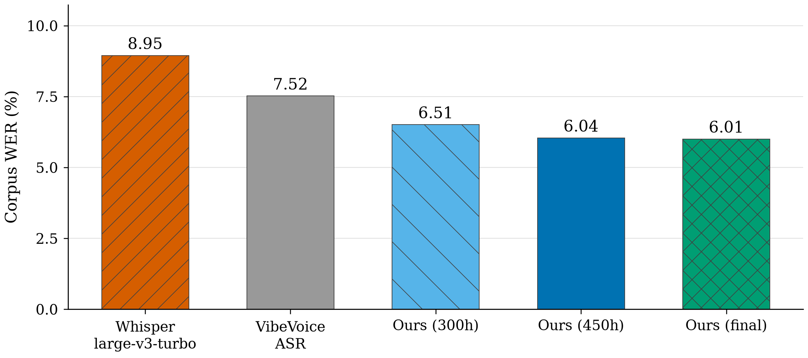
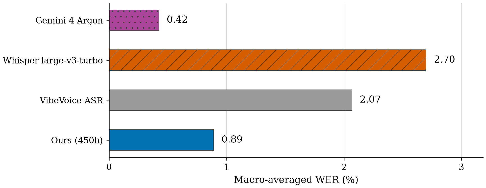

# ASR

VibeVoice fine-tuning for Czech and Slovak using QLoRA.



**Figure 1.** Checkpoint comparison.



**Figure 2.** Model comparison.

## Reproduce

```sh
uv run --no-project --python /usr/bin/python scripts/build_result_charts.py
```
