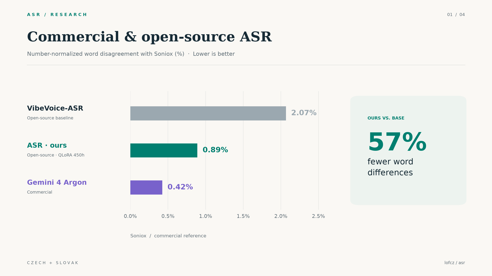
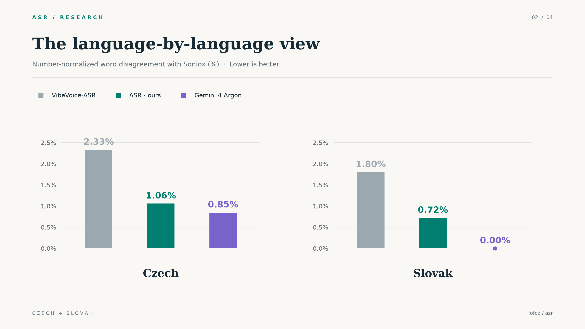
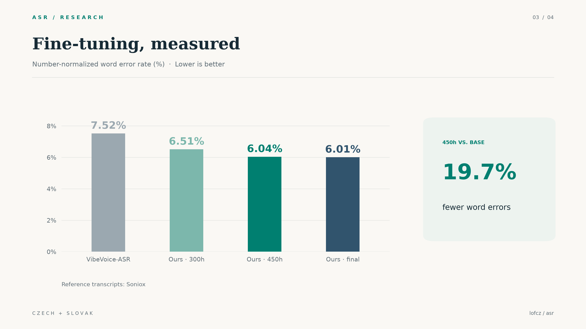
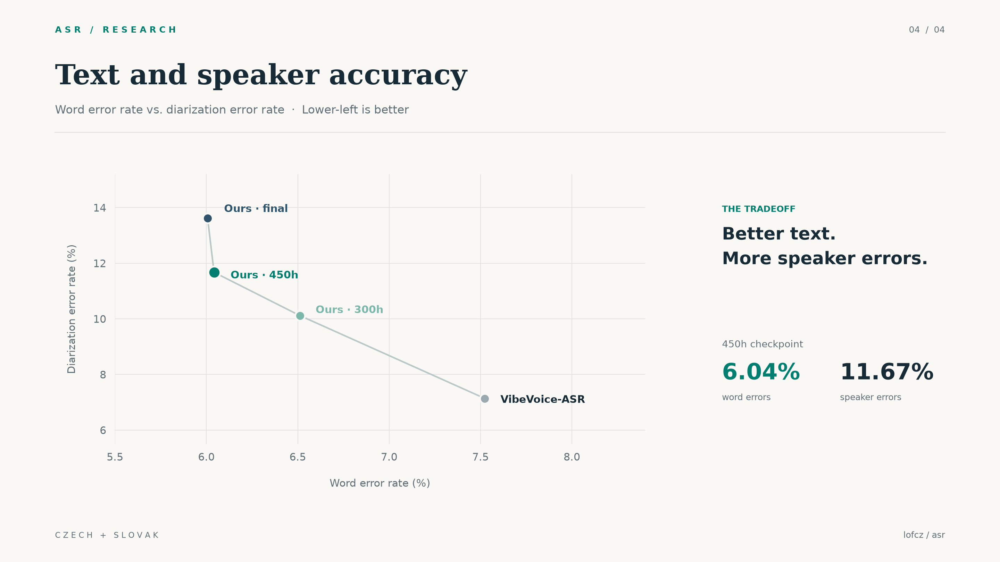

# ASR results

Four charts comparing the saved commercial and open-source outputs, language performance, and fine-tuning results. Teal identifies our 450h checkpoint; purple identifies Gemini; gray identifies the VibeVoice-ASR baseline.

[Download the four-page PDF](asr-results.pdf) · [Chart values](values.csv) · [Evidence snapshot](results.json)



[SVG](01-commercial-open-source.svg) · [PDF](01-commercial-open-source.pdf)



[SVG](02-language-comparison.svg) · [PDF](02-language-comparison.pdf)



[SVG](03-checkpoint-progress.svg) · [PDF](03-checkpoint-progress.pdf)



[SVG](04-text-speaker-tradeoff.svg) · [PDF](04-text-speaker-tradeoff.pdf)

<details>
<summary>Data and methodology</summary>

The commercial comparison uses the two saved Czech/Slovak generated-dialogue markers: 11.48 minutes and 1,776 reference words. Soniox supplied the accepted reference transcripts. Gemini 4 Argon's independent transcription, base VibeVoice-ASR, and our selected 450h QLoRA checkpoint are scored against the same references. Soniox is not assigned an artificial zero-error competitor score.

All three systems use the existing `cs-sk-cardinals-v1` number normalizer. Punctuation and case are normalized; diacritics remain significant. The Gemini score is recomputed from the saved independent output, before adjudication. The chart average gives Czech and Slovak equal weight. Our reduction is 56.9% relative to the base model's mean word disagreement; Gemini's lower disagreement is shown directly. Its 0.00% Slovak value means zero normalized word edits against that particular Soniox transcript.

Checkpoint progress and the text/speaker scatter use all eight recordings in the release evaluation's `new-confirmation` cohort: four per language, 79.83 minutes and 11,271 normalized reference words. All four checkpoints have scored results on this identical cohort. Word error rate pools word edits and reference words; diarization error rate pools error seconds and scored speaker seconds with a 250 ms collar. The 450h checkpoint reduces word edits from 848 to 681, or 19.7%. Its speaker error rate increases from 7.14% to 11.67%. One of its eight scored outputs is not strictly valid in its raw form; the source report retains that distinction.

This cohort was consumed for release selection. The two dialogue markers were also used repeatedly during development. Machine-reference agreement is not independent human-ground-truth accuracy and does not establish a general SOTA ranking.

The full [release report](../experiments/qda-v1-release-eval/report.md) covers 32 main recordings and two additional long sessions. The recommended 450h checkpoint completes 32/32 main recordings but 0/2 unchunked long sessions. The final checkpoint has the lowest full-panel WER point estimate; its difference from 450h is unresolved by the saved paired show-level interval. The 450h candidate was selected using the report's completion, text, and speaker-error criteria.

The committed snapshot includes numeric results, validity counts, the full-panel comparison intervals, model revision, and SHA-256 hashes of 20 source artifacts. Original audio, transcripts, credentials, and production identifiers are excluded. Extraction checks matching audio/reference/adapter identities and reproduces all six marker word scores, including the original Gemini audit before number normalization.

</details>

## Rebuild

From the repository root, using [uv](https://docs.astral.sh/uv/):

```sh
uv run --no-project --python /usr/bin/python scripts/build_result_charts.py
```

This reads the committed snapshot and needs no audio, checkpoints, API calls, or training environment. Dependencies are declared in the script. The outputs are 2880 × 1620 PNGs, vector SVGs, individual PDFs, a combined PDF, and CSV values.

To verify and refresh the snapshot from the original local evaluation artifacts:

```sh
uv run --no-project --python /usr/bin/python scripts/build_result_charts.py --refresh-data
```
